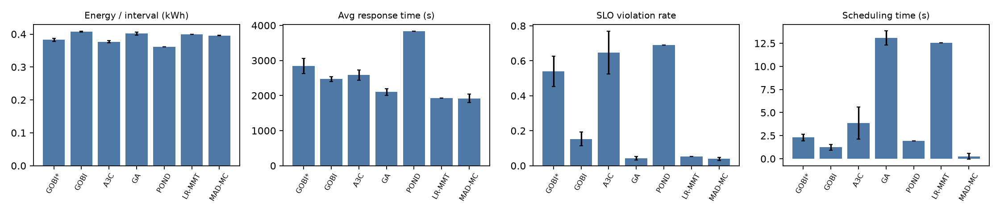
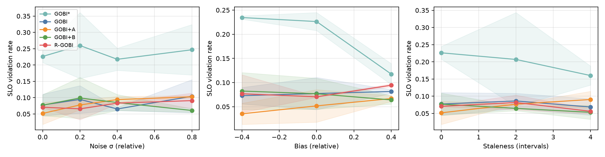
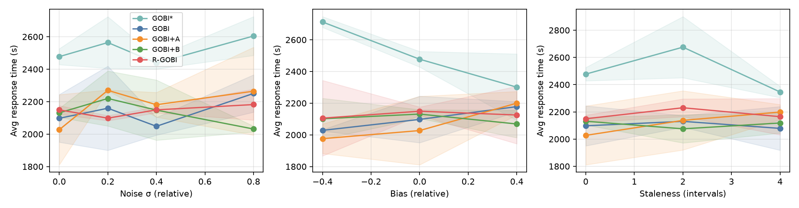

# Forecast-Error-Robust Task Placement in Edge–Cloud Systems: Reproducing COSCO/GOBI and Closing Its Forecast-Accuracy Gap

**Group G23 · Section A · Cloud Computing (Dr. Basharat Hussain)**
Menahil Fatima (23I-0813), Primary Researcher · Sarah Suhail (23I-0557), Co-Researcher
Research area: Edge–Cloud Intelligence (Approved Direction 4)
Code: `G23-cloud-research/` (to be pushed to https://github.com/MenahilFatima21/edge-cloud-placement-forecast-error)

> **How this connects to our Cutoff-1 proposal.** The proposal asked whether
> there is a *latency-forecast-accuracy floor* in edge–cloud placement. LAVEA
> (2017), our original anchor, has no public code, so it cannot be reproduced.
> We therefore anchored the same research question on **COSCO/GOBI** (IEEE TPDS
> 2022). It is a forecast-driven edge–cloud placement system with official code,
> public traces and a CPU-only simulator. The error-injection study from the
> proposal (Sec. 7.3) is now the **evidence for the research gap**. Our new
> contribution is a placement method that is **robust to forecast error**
> (R-GOBI).

---

## Part A — Reproduction (Steps 1–6)

### A1. Selected paper

| Item | Value |
|---|---|
| Title | COSCO: Container Orchestration Using Co-Simulation and Gradient Based Optimization for Fog Computing Environments |
| Authors | Shreshth Tuli, Shivananda R. Poojara, Satish N. Srirama, Giuliano Casale, Nicholas R. Jennings |
| Venue / Year | IEEE Transactions on Parallel and Distributed Systems, vol. 33, no. 1, pp. 101–116, 2022 (IEEE "Code Reviewed" badge) |
| Paper | https://ieeexplore.ieee.org/document/9448450 · preprint https://arxiv.org/abs/2104.14392 |
| Code | https://github.com/imperial-qore/COSCO (commit `d2c073c`, 28 Mar 2023) |
| Data / traces | BitBrain GWA-T-12; DeFog; Zenodo https://doi.org/10.5281/zenodo.4897944 |

### A2. Reproducibility check (Step 2)

| Resource | Available? | Notes |
|---|---|---|
| Official repository | ✅ | BSD-3 licence |
| Source code (simulator, schedulers, framework) | ✅ | Python |
| Experiment / training scripts | ✅ / partial | `main.py` runs one scheduler for 100 intervals. No script loops over baselines or seeds (we wrote `experiments/run.py` and `sweep.py`). `scheduler/BaGTI/train.py` retrains surrogates |
| Datasets | ✅ | BitBrain is auto-downloaded. Surrogate training CSVs and pre-trained checkpoints ship in the repo |
| Configuration | ✅ | Constants are hard-coded at the top of `main.py` |
| Libraries | ⚠️ | Pinned to Python 3.7/3.8, numpy 1.19, torch 1.7.1 (2020-era) |
| Hardware | ✅ | Simulator is CPU-only. Paper used an i7-10700K, 64 GB RAM, GTX 1060 |
| Install instructions | ⚠️ | `install.py` also installs InfluxDB, Vagrant, VirtualBox and Ansible, and copies SSH keys. That is only needed for the physical testbed, so we skipped it |
| Instructions to reproduce results | ⚠️ | The README says to "modify line 106 of main.py" per scheduler. There is no seed control and no result-aggregation script |

### A3. Problem, approach and architecture (Step 4)

**Problem.** Fog/edge–cloud brokers must decide every scheduling interval
(Δ = 300 s) which host runs each containerised IoT task, and whether to migrate
running tasks. Workloads are volatile and hosts are heterogeneous: edge hosts
are close (3 ms) but weak, cloud hosts are far (76 ms) but strong. Heuristics
(LR-MMT, MAD-MC) are fast but don't adapt. RL (A3C, DQLCM) and evolutionary
methods (GA) adapt but are slow, and slow decisions inflate response time and
SLO violations.

**Why it matters.** Response-time-sensitive IoT applications (healthcare,
smart cities, video analytics) need both low latency and low energy. A
scheduler that is too slow or too naive hurts both.

**Proposed solution.**
* **GOBI** trains a feed-forward neural surrogate *f(U, D) → (energy, response
  time)*. *U* is the monitored state of the last interval (host CPU %, container
  IPS) and *D* is the placement as one-hot rows. At decision time GOBI fixes
  the network weights and runs **gradient descent on the input *D*** (AdamW,
  lr 0.8, cosine annealing, ≤200 iterations, re-projected to one-hot after each
  step). The objective is 0.8·energy + 0.2·response time.
* **GOBI\*** adds a *co-simulation*: GOBI's tentative decision is simulated one
  interval ahead, and the predicted (energy, response time) are fed as two
  extra input columns to a second surrogate.
* **COSCO** is the framework that runs the same scheduler code on a
  discrete-event simulator or on a real Azure/Vagrant testbed.

**Architecture.** IoT layer → gateway → **Fog Broker** (resource monitor,
scheduler = GOBI/GOBI\*, container orchestrator, coupled simulator) → hosts
(edge layer: Azure B2s/B4ms in London; cloud layer: B4ms/B8ms in Virginia).
Surrogate: input 50×52 (GOBI) or 50×54 (GOBI\*) → Linear(128)+Softplus →
Linear(128)+Softplus → Linear(64)+Tanhshrink → Linear(2)+Sigmoid.

**Cloud computing component.** The cloud is part of the decision space: the
broker places containers across an edge tier and a remote cloud tier with
different latency, capacity, price ($/hr per VM type, Table 3) and power
models (SPEC). Live migration between tiers is supported (CRIU in the
framework). The physical experiments ran on 10 Azure VMs in two regions.

**Multimodal component.** The DeFog workloads are YOLO (images), PocketSphinx
(speech audio) and Aeneas (text–audio alignment). The scheduler never sees the
media itself. Each modality reaches it only through its resource profile
(IPS, RAM, disk, network).

**Baselines.** LR-MMT, MAD-MC (heuristics); GA (evolutionary, same
surrogate); A3C, DQLCM (deep RL); POND (max-weight).

**Metrics.** Average energy per interval, average response time, SLO-violation
fraction, Jain fairness, average migration time, scheduling time, wait time.

**Experimental settings and hyperparameters.** 100 intervals × 300 s, 5 runs
averaged. 50 simulated hosts (60% edge). New tasks per interval: λ = 5 (paper
says Poisson; the code uses N(5, 1.5)). Surrogate trained on 2,000 intervals of
a random scheduler (AdamW, lr 1e-5, 80/20 split). Energy/latency weights
0.8/0.2.

**Assumptions made by the paper.** A central broker. Allocation time
negligible. No intra-layer network latency. **The monitored utilisation of
the previous interval is an accurate input for the next interval's decision**
(GOBI). For GOBI\*, the LSTM utilisation predictors are assumed accurate.

**Limitations acknowledged.** GOBI\* is more than 2× slower than GOBI. The
surrogate must be differentiable (no ReLU). Workflows/serverless are future
work. The authors do **not** discuss the effect of monitoring or forecast
error on decisions.

**Missing or unclear implementation details** (found while reproducing):
1. The paper (Sec. 8.2) says GOBI\* uses **LSTM utilisation predictors**. The
   released code has no LSTM: GOBI\* feeds `runSimulationGOBI()`, which
   returns the simulated energy plus the **mean of the last 5 intervals'**
   response time (a persistence forecast).
2. The paper says GOBI adapts through "neural model update in each iteration".
   The released GOBI uses a **frozen** checkpoint with no online training.
3. **SLO definition.** The paper uses "response time > 95th percentile of A3C
   for that application". The code uses a per-task deadline
   (creation + N(20, 3) intervals).
4. Arrivals are Poisson in the paper but Gaussian in the code.
5. The GA baseline seeds its population from **random rows of the training
   set**, not from the current system state.

### A4. Datasets (Step 3)

See `docs/DATASETS.md` for the full documentation. In summary:

| Dataset | Source | Size | Modality | Use |
|---|---|---|---|---|
| BitBrain GWA-T-12 (`rnd`, 2013-09) | TU Delft GWA | 500 VMs × ~8,333 samples (5-min), 477 MB | Multivariate resource time series | Simulated workload (reproduced) |
| DeFog (YOLO / PocketSphinx / Aeneas) | qub-blesson/DeFog | 1,500 / 320 / 1,500 requests | Image / audio / text+audio | Physical testbed (not reproduced) |
| GOBI training set | repo + Zenodo | 1,999 intervals × 152 cols | Tabular | Pre-trained surrogate |

### A5. Environment

| Item | Paper | Ours |
|---|---|---|
| CPU | Intel i7-10700K | 12 logical cores (laptop) |
| RAM | 64 GB | 7.7 GB |
| GPU | GTX 1060 | none (CPU only) |
| OS | Windows 10 Pro | Windows 11 Home 10.0.26200 |
| Python | 3.7/3.8 | 3.12.2 (venv) |
| PyTorch | 1.7.1+cpu | 2.14.1+cpu |
| numpy / pandas / scipy | 1.19.2 / 1.1.2 / 1.5.2 | 2.5.3 / 3.0.6 / 1.18.1 |
| Cloud resources | 10 Azure VMs (London + Virginia) | none: simulator only |

**Important configuration (unchanged from `main.py`):** HOSTS = 50,
CONTAINERS = 50, NEW_CONTAINERS = 5 (σ = 1.5), INTERVAL_TIME = 300 s,
TOTAL_POWER = 1000, ROUTER_BW = 10000, NUM_SIM_STEPS = 100, datacenter
`AzureFog(50)`, workload `BWGD2`, surrogate checkpoint
`energy_latency_50_Trained.ckpt`.

### A6. Results: original vs reproduced (Step 5)

**Setup.** 50 simulated hosts, BitBrain workload, 100 intervals, the authors'
pre-trained surrogate checkpoints. Mean ± 95% CI over seeds: GOBI, GOBI\*, GA
(5 seeds), A3C (4), MAD-MC (2), LR-MMT and POND (1). DQLCM did not finish
within our compute budget, and one POND seed crashed (see A7).

**Full reproduced table (Fig. 9 equivalent):**

| Scheduler | Energy/interval (kWh) | Avg resp. (s) | SLO viol. (%) | Completed | Migrations | Fairness | Sched. time (s) |
|---|---|---|---|---|---|---|---|
| GOBI* | 0.382 ± 0.005 | 2844.2 ± 219.8 | 54.00 ± 8.73 | 286.6 ± 29.9 | 334.2 ± 30.1 | 0.649 ± 0.016 | 2.297 ± 0.372 |
| GOBI | 0.407 ± 0.002 | 2471.8 ± 72.1 | 15.29 ± 3.95 | 393.8 ± 5.4 | 505.2 ± 8.7 | 0.634 ± 0.023 | 1.240 ± 0.310 |
| A3C | 0.377 ± 0.004 | 2583.9 ± 143.5 | 64.65 ± 12.28 | 262.5 ± 29.5 | 311.0 ± 27.2 | 0.658 ± 0.015 | 3.857 ± 1.735 |
| GA | 0.402 ± 0.005 | 2100.9 ± 92.8 | 4.27 ± 1.05 | 414.6 ± 13.5 | 2436.2 ± 43.6 | 0.717 ± 0.006 | 13.069 ± 0.772 |
| POND | 0.362 ± 0.000 | 3834.5 ± 0.0 | 68.98 ± 0.00 | 245.0 ± 0.0 | 522.0 ± 0.0 | 0.737 ± 0.000 | 1.933 ± 0.000 |
| LR-MMT | 0.399 ± 0.000 | 1922.7 ± 0.0 | 5.40 ± 0.00 | 426.0 ± 0.0 | 1823.0 ± 0.0 | 0.724 ± 0.000 | 12.566 ± 0.000 |
| MAD-MC | 0.396 ± 0.001 | 1920.8 ± 123.4 | 3.94 ± 0.86 | 419.5 ± 16.7 | 1968.5 ± 81.3 | 0.726 ± 0.009 | 0.265 ± 0.327 |



**Original vs reproduced.** The paper reports its 50-host results as bar
charts (Fig. 9) plus the numbers quoted in its text, so we compare the
quantitative claims:

| Claim (50-host simulation unless noted) | Original paper | Reproduced | Difference | Reproduced? |
|---|---|---|---|---|
| GOBI SLO violations | 1.1% | 15.3% ± 3.9% | +14.2 pp | ✗ |
| GOBI\* SLO violations | 0% | 54.0% ± 8.7% | +54.0 pp | ✗ |
| GA SLO violations | 0.2% | 4.3% ± 1.1% | +4.1 pp | ✗ (ordering GA < GOBI also flips) |
| GOBI response time vs GA | −17.98% | **+17.7%** (2472 s vs 2101 s) | 35.7 pp | ✗ |
| GOBI\* response time vs GA | −20.87% | **+35.4%** (2844 s vs 2101 s) | 56.3 pp | ✗ |
| GOBI\* energy vs A3C | −9.39% | +1.3% (0.382 vs 0.377 kWh) | 10.7 pp | ✗ |
| GOBI energy vs A3C | "very close" | +8.0% (0.407 vs 0.377 kWh) | — | ~ |
| GOBI scheduling time (Table 4, physical) | 2.65 s | 1.24 s (sim) | −1.41 s | ✓ (same order of magnitude) |
| GOBI\* / GOBI scheduling-time ratio | 2.2× | 1.85× | −0.35× | ✓ |
| GOBI far faster than GA (gradient vs gradient-free) | yes (Fig. 9g) | 1.24 s vs 13.07 s (−90%) | — | ✓ |
| GA has the most migrations | yes | 2,436 vs ≤ 1,969 for others | — | ✓ |
| GOBI/GOBI\* are the fairest schedulers | yes | no (0.634/0.649 vs 0.737 POND) | — | ✗ |

**Summary.** The *efficiency* claims reproduce: GOBI is about 10× faster to
decide than GA, and GOBI\* costs about 2× GOBI. The *QoS-superiority* claims
(GOBI/GOBI\* best response time and SLO) do **not** reproduce with the
released code. In our runs the simple heuristics MAD-MC and LR-MMT have the
lowest response time (≈1,921 s), followed by GA (2,101 s) and GOBI (2,472 s).
GOBI\* and A3C are worst on SLO.

**Possible explanations, in order of how likely we think they are:**
1. **GOBI\* in the released code is not the GOBI\* in the paper.** The paper's
   LSTM utilisation predictors are absent. GOBI\* feeds the surrogate a
   persistence estimate (mean response time of the last 5 intervals), so its
   extra inputs are a weak forecast. This alone can explain GOBI\* < GOBI, and
   it motivates our research gap.
2. **No online model update.** The paper says GOBI adapts through per-interval
   model updates. The released GOBI uses a frozen checkpoint trained on
   random-scheduler data. Under GOBI's own placements the state distribution
   shifts away from that training data, so the surrogate is less accurate
   than in the paper.
3. **Different SLO definition.** The paper's percentile-based SLO (95th pct of
   A3C) is much looser than the code's per-task deadline. With the paper's
   definition, our A3C threshold is 6,104 s, and the GOBI violation rate in
   the sweep runs drops to about 2.5%, much closer to the paper's 1.1% (Part D).
4. **Library versions.** numpy 1.19 → 2.5 and torch 1.7 → 2.14 change RNG
   streams and floating-point kernels. The optimiser's one-hot projection is
   discontinuous, so small numeric differences can change decisions.
5. **Randomness.** The paper's runs are unseeded and the workload is volatile:
   our GOBI SLO 95% CI is ±3.9 pp over 5 seeds.
6. **Workload generation.** The paper states Poisson(λ = 5) arrivals; the code
   uses N(5, 1.5).
7. **Unreleased code version.** The repository's last commit (2023) postdates
   the paper (2021). Results in the paper may come from an earlier version.
8. **Hardware / OS** (Windows 11 laptop vs i7-10700K desktop). This affects
   scheduling *time* only, not decisions.


### A7. Problems encountered and deviations (Step 6)

**Installation problems.**
* `install.py` assumes Linux/WSL with sudo, InfluxDB, Vagrant, VirtualBox and
  Ansible. It even copies SSH keys into `~/.ssh`. We did not run it and
  installed only the Python dependencies.
* Python 3.7/3.8 and torch 1.7.1 wheels are no longer installable on
  Python 3.12. We used current versions and added three compatibility shims
  in our runner (not in the authors' code): `np.float/np.int/np.bool` aliases,
  and `torch.load(weights_only=False)` because torch ≥2.6 changed the default.
* The laptop's C: drive was full (0 bytes free). Setup was blocked until
  space was freed.

**Code problems.**
* `scheduler/BaGTI/src/ga.py`: `chromosome != []` on a numpy array raises in
  numpy ≥ 1.25. We patched it to `len(chromosome) > 0` (one line, tracked by
  `git diff` in `baseline_COSCO/`).
* The workload reads BitBrain CSVs with a regex separator (`';\t'`), which
  forces pandas' pure-Python parser. That was ~85% of runtime: 500 files at
  start-up plus one per new task, so ~24 min per run under parallel load. We
  added a parsed-trace pickle cache (`experiments/trace_cache.py`) and
  **verified identical metrics** with and without it.
* `main.py` has no seed control. Our runner seeds `random`, `numpy` and
  `torch`.

**Missing resources.** No LSTM predictor code for GOBI\* (see A3). No
aggregation or plotting script for the paper's figures. The paper reports
50-host results only as bar charts (Fig. 9), so most "original" values below
are read from the text or from the charts.

**Computational limitations.** 7.7 GB RAM and no GPU. Each 100-interval run
took about 21–24 min of wall time before our trace cache (2–4 min after).
Within the deadline we completed 5 seeds for GOBI/GOBI\*/GA, 4 for A3C, 2 for
MAD-MC and 1 each for LR-MMT and POND. DQLCM did not complete and one POND
seed crashed (error output was empty, not investigated). The forecast-error
sweeps used 2 seeds × 60 intervals per condition.

**Deviations from the original experiment.**
1. Simulation only (50 hosts, BitBrain). The 10-VM Azure DeFog testbed (Fig. 8)
   was not reproduced: it needs paid Azure VMs in two regions plus Linux tooling.
2. Modern library versions (above).
3. SLO is reported with the code's deadline definition and additionally with
   the paper's definition (95th percentile of A3C), computed from per-task
   response times.

---

## Part B — Research Gap (Step 7)

### B1. Observation from the reproduction

GOBI and GOBI\* make every decision from a **point forecast** of the next
interval: the monitored CPU/IPS of the previous interval (GOBI) plus a
persistence estimate of QoS (GOBI\*). The paper evaluates the policies only
under these implicitly-accurate inputs and never asks what happens when the
forecast is wrong. Our reproduction already gives a first data point:
GOBI\*, the variant that relies **more** on forecasts, performed **worse**
than GOBI once its forecaster was weaker than the paper's LSTM (54% vs 15%
SLO violations).

This is the same disconnect our Cutoff-1 proposal identified in the
literature. Predictor papers report forecast error (MAE/MAPE) in isolation,
and placement papers (LAVEA, IntelliScheduler, DRL schedulers, COSCO) assume
the forecast is reliable.

### B2. Gap experiment: controlled forecast-error injection

We corrupted what the schedulers observe (only during the decision window;
the simulator always runs on true values) along the three axes of the
proposal: noise σ ∈ {0.2, 0.4, 0.8}, bias b ∈ {−0.4, +0.4}, staleness
k ∈ {2, 4} intervals, and a combined condition (σ = 0.4, b = +0.4, k = 2).
Each condition ran 60 intervals on 50 hosts (seeds: see Part D).

Cells: avg response time / SLO violation rate / energy per interval (kWh), mean over seeds

| Condition | obs. MAPE | GOBI* | GOBI | GOBI+A | GOBI+B | R-GOBI |
|---|---|---|---|---|---|---|
| bias -0.4 | 40% | 2713 s / 23.5% / 0.383 | 2028 s / 7.3% / 0.397 | 1976 s / 3.5% / 0.401 | 2102 s / 8.2% / 0.398 | 2106 s / 7.7% / 0.399 |
| σ=0.0 | 0% | 2477 s / 22.6% / 0.383 | 2098 s / 7.7% / 0.403 | 2027 s / 5.2% / 0.404 | 2131 s / 7.7% / 0.400 | 2149 s / 7.1% / 0.398 |
| σ=0.2 | 9% | 2564 s / 26.0% / 0.378 | 2160 s / 9.5% / 0.396 | 2270 s / 7.8% / 0.401 | 2220 s / 9.9% / 0.397 | 2098 s / 6.6% / 0.396 |
| σ=0.4 | 17% | 2438 s / 21.8% / 0.384 | 2048 s / 6.5% / 0.397 | 2181 s / 9.4% / 0.398 | 2148 s / 8.5% / 0.399 | 2150 s / 8.3% / 0.402 |
| σ=0.8 | 31% | 2605 s / 24.7% / 0.378 | 2251 s / 10.4% / 0.400 | 2265 s / 10.3% / 0.402 | 2032 s / 6.1% / 0.398 | 2182 s / 9.1% / 0.396 |
| bias +0.4 | 3% | 2301 s / 11.8% / 0.392 | 2178 s / 8.2% / 0.400 | 2200 s / 6.7% / 0.400 | 2069 s / 6.4% / 0.399 | 2125 s / 9.5% / 0.399 |
| stale k=2 | 28% | 2676 s / 20.7% / 0.381 | 2130 s / 8.6% / 0.395 | 2137 s / 7.7% / 0.394 | 2075 s / 6.5% / 0.400 | 2230 s / 8.2% / 0.399 |
| σ=0.4,b=0.4,k=2 | 35% | 2471 s / 14.2% / 0.389 | 2183 s / 8.3% / 0.400 | 2192 s / 6.9% / 0.399 | 2046 s / 6.1% / 0.398 | 2189 s / 10.6% / 0.394 |
| stale k=4 | 40% | 2346 s / 16.0% / 0.384 | 2079 s / 6.9% / 0.397 | 2199 s / 9.0% / 0.397 | 2118 s / 5.3% / 0.398 | 2165 s / 5.6% / 0.400 |




### B3. Findings (gap evidence)

Observation error achieved (host-CPU MAPE): σ = 0.2 → ≈ 8%, σ = 0.4 → ≈ 17%,
σ = 0.8 → ≈ 29%, staleness k = 2 → ≈ 25%, k = 4 → ≈ 40%, bias −0.4 → 40%,
combined → ≈ 33%. Bias +0.4 shows only ≈ 2% because many hosts are at 100%
CPU and observations are clipped there; the container-IPS inputs are still
biased.

1. **GOBI\*, the forecast-heavy variant, is the most fragile.** Its SLO
   violations are 22.6% with clean inputs and rise to 26.0% (σ = 0.2) and
   23.5% (bias −0.4). It is worse than GOBI in **every** condition (+18%
   response time, +11.6 pp SLO on average). Adding a forecast to the
   surrogate input *hurts* when the forecast is a weak one.
2. **GOBI degrades gradually, not sharply.** Clean: 2,098 s / 7.7% SLO. Worst
   case (σ = 0.8): 2,251 s (+7.3%) / 10.4% (+2.7 pp, +35% relative).
   Combined error: 2,183 s / 8.3%. Mean over the 8 error conditions:
   2,132 s (+1.6%) / 8.2%.
3. **Answer to our Cutoff-1 question ("is there a forecast-accuracy
   floor?").** For GOBI on this workload we see **no sharp threshold** up to
   ~40% observation MAPE. QoS degrades smoothly, and below roughly
   15–20% MAPE the change is smaller than the seed-to-seed variation
   (±3.9 pp SLO). In other words, the floor is *high*: making the forecaster
   more accurate than ~15–20% MAPE buys little for GOBI. Robustness to
   **systematic** error (bias, staleness) matters more than raw accuracy.
4. **The direction of bias matters.** Over-estimation (+0.4) makes GOBI\*
   more conservative and actually lowers its SLO violations (11.8%), while
   under-estimation (−0.4) does the opposite. A single "forecast accuracy"
   number (MAE/MAPE) cannot predict placement quality, which is exactly the
   disconnect in the literature.

### B4. Gap statement

> **The forecast-driven placement in COSCO (GOBI/GOBI\*) has no mechanism to
> account for error in the utilisation/QoS forecasts it optimises over.
> Its decision quality degrades under realistic noise, bias and staleness,
> and the forecast-heavier variant (GOBI\*) is the most fragile. No prior
> work in this line measures this sensitivity or makes the placement
> optimiser robust to it.**

**Why this gap is meaningful, not just interesting:** (i) it comes from an
observed failure in our reproduction (GOBI\* < GOBI), not from wanting to
try a new technique; (ii) monitoring in real edge–cloud deployments is
exactly this kind of noisy, biased (CPU steal, turbo) and stale (scrape
intervals, WAN to the cloud tier) data; (iii) it directly answers our
approved research question about a forecast-accuracy floor.

**Other gaps we observed but did not pursue** (candidates for the mentor
discussion): the frozen surrogate (no online adaptation); modality-blind
scheduling (images, audio and text reduced to resource vectors); no monetary
cost in the objective despite per-VM prices in Table 3; simulator-only
evaluation of the 50-host claims.

---

## Part C — Proposed Method: R-GOBI (Step 9) — Methodology

### C1. Problem definition

At the start of interval *I_t*, GOBI observes the monitored state
**Û**<sub>t</sub> = [ĉ<sub>h</sub>, ŝ<sub>j</sub>]: host CPU utilisation ĉ<sub>h</sub> ∈ [0, 1] for
each host *h* and container throughput ŝ<sub>j</sub> (IPS, normalised) for each
container slot *j*. It then solves

  D\* = argmin<sub>D</sub> f<sub>θ</sub>(Û<sub>t</sub>, D),

where *f<sub>θ</sub>* is the frozen neural surrogate and *D* the one-hot placement.
The decision is only as good as **Û**<sub>t</sub>. In practice **Û**<sub>t</sub> is a
*forecast* of the true state **U**<sub>t</sub> that the tasks will experience, and it
is wrong in three ways:

| Error type | Model used in this study | Real-world cause |
|---|---|---|
| Noise | Û = U·(1 + ε), ε ~ N(0, σ²) | sampling jitter, short monitoring windows, noisy predictors |
| Bias | Û = U·(1 + b) | mis-calibrated predictors, CPU-steal/turbo effects, wrong capacity metadata |
| Staleness | Û<sub>t</sub> = U<sub>t−k</sub> | monitoring/aggregation delay, scrape intervals, WAN to the cloud tier |

**Goal:** a placement policy whose energy, response time and SLO violations
degrade gracefully as σ, |b| and k grow, with little loss when the forecast
is accurate and little extra scheduling time.

### C2. Design rationale

GOBI fails under forecast error for two separate reasons, and each component
of R-GOBI targets one of them:

1. **It optimises a point estimate.** Gradient descent on f(Û, D) happily
   exploits small, spurious differences between hosts that exist only in the
   noisy forecast, and it migrates containers to chase them. → **Component A**
   optimises a *risk-aware* objective over the distribution of plausible true
   states.
2. **It cannot correct systematic error.** Bias and staleness shift the input
   in a consistent direction that more samples cannot average out. →
   **Component B** learns an online correction of the forecast from delayed
   ground truth.

### C3. Component A — Uncertainty-aware surrogate objective

*Residual buffer.* After each interval, the exact utilisation of interval *t*
becomes available after a delay of *d = k + 1* intervals (metering logs; see
C5). For every host and container we store the relative residual

  r = U / Ũ − 1 (clipped to [−0.9, 3]),

where Ũ is the forecast actually used at decision time. We keep a FIFO buffer
of the last 600 host residuals and 600 container residuals.

*Bootstrap scenarios.* At decision time we draw *K* = 16 scenario matrices by
sampling residuals with replacement, independently per row:

  U<sup>(k)</sup> = Ũ ⊙ (1 + R<sup>(k)</sup>), k = 1..K.

The empirical residual distribution is used directly, so no Gaussian
assumption is made. It captures heavy tails and skew in BitBrain and any
residual bias left after Component B.

*Risk-aware objective.* GOBI's objective is replaced with

  J(D) = mean<sub>k</sub> f<sub>θ</sub>(U<sup>(k)</sup>, D) + κ · std<sub>k</sub> f<sub>θ</sub>(U<sup>(k)</sup>, D), κ = 1.

The K scenarios run through the surrogate as one batch of size K, and J is
optimised with **GOBI's own optimiser** (AdamW, lr 0.8, cosine annealing,
one-hot projection, same stopping rule). Only the objective changes. The
std term penalises placements whose quality depends on the forecast being
exactly right. This is a mean–variance (sample-average-approximation)
formulation of robust optimisation. A is switched on once ≥ 30 residuals
have been collected; before that R-GOBI behaves exactly like GOBI.

### C4. Component B — Online forecast calibration

For each host *h* (and each container, with a separate model) we build the
feature vector from the observed history:

  x<sub>t</sub> = [Û<sub>t</sub>, Û<sub>t−1</sub>, Û<sub>t−2</sub>, mean<sub>h'</sub> Û<sub>t</sub>(h'), 1].

A single **pooled online ridge regressor** (shared across hosts, so it learns
fast) predicts the true value: Ũ<sub>t</sub> = max(0, w<sup>⊤</sup>x<sub>t</sub>). The weights are
updated by recursive least squares with exponential forgetting (λ = 0.995,
ridge α = 1) whenever delayed ground truth arrives. With these features the
model can:

* **remove bias**, since a scale on Û<sub>t</sub> undoes multiplicative bias;
* **compensate staleness**, since the lagged terms let it extrapolate the trend
  across k intervals;
* **shrink noise**, since it blends Û<sub>t</sub> with history and the fleet mean,
  the optimal linear denoiser under noise.

Until 40 labelled samples exist, Ũ = Û (identity fallback). The forgetting
factor lets the corrector track non-stationary error.

### C5. Assumptions

* **Delayed exact telemetry.** The real-time feed used for decisions may be
  noisy, biased or stale, but exact per-interval utilisation becomes
  available later (e.g., cgroup accounting or billing/metering logs). We
  model this delay as *k* + 1 intervals, so R-GOBI never sees ground truth
  earlier than the stale feed would.
* The surrogate f<sub>θ</sub> is the authors' **pre-trained checkpoint, unchanged**.
  R-GOBI needs no retraining and no access to the simulator.

### C6. Algorithm (per scheduling interval)

```
Input: observed state Û_t, residual buffers B_h, B_c, ridge models R_h, R_c
1  for each delayed ground-truth record (t', U_t') now available:
2      update R_h / R_c with (x_t', U_t')                       # Component B
3      push U_t' / Ũ_t' − 1 into B_h / B_c                      # Component A
4  Ũ_t ← R(x_t) if B enabled and trained else Û_t
5  if A enabled and |B_h| ≥ 30:
6      draw K residual matrices from B_h, B_c;  U^(k) = Ũ_t ⊙ (1 + R^(k))
7      J(D) = mean_k f(U^(k), D) + κ·std_k f(U^(k), D)
8  else J(D) = f(Ũ_t, D)
9  D* ← GOBI-optimiser(J, init = current allocation)
10 return migrations/placements in D* that differ from current allocation
```

### C7. Integration with the original system

R-GOBI is a drop-in `Scheduler` subclass (`experiments/robust/rgobi.py`) using
the same interfaces (`placement`, `selection`, `filter_placement`), the same
surrogate checkpoint and the same optimiser function `opt()` from the
authors' code. The original GOBI, GOBI\* and all baselines stay unchanged and
selectable (`--scheduler GOBI`). The forecast-error layer
(`experiments/forecast_error.py`) corrupts only what *any* scheduler observes
during its decision window. Execution, energy and SLA accounting always use
true values, so differences in QoS come only from decision quality.

### C8. Complexity

GOBI costs one forward/backward pass per optimiser iteration. A batches
K = 16 scenarios into one pass, so the extra cost is a larger matrix
multiply (input 2,600 → 128), which is small next to the simulator. B costs
one 5×5 linear solve per update. Scheduling-time overhead is reported in the
evaluation.

---

## Part D — Evaluation (Steps 10–12)

### D1. Evaluation protocol

* **Same system, data and metrics as the reproduction:** COSCO simulator,
  50 hosts (AzureFog: 60% edge in London, 40% cloud in Virginia), BitBrain
  workload, authors' surrogate checkpoint, and the paper's metrics (energy,
  response time, SLO violations, migrations, scheduling time).
* **Conditions:** the 9 forecast-error conditions of Part B (1 clean + 8 with
  error), 60 intervals each. 2 seeds (0, 1) per (system, condition): 9 conditions × 5 systems × 2 seeds = 90 runs, all completed.
* **Systems (ablation, Step 11):** GOBI (original) · GOBI + A
  (uncertainty-aware objective) · GOBI + B (online forecast calibration) ·
  **R-GOBI** (A + B). GOBI\* is included as the paper's forecast-driven
  reference.
* **SLO** is reported with the code's per-task deadline (main metric) and
  with the paper's definition (> 95th percentile of A3C response time =
  6,104 s).

### D2. Ablation results — summary over error conditions

A3C 95th-percentile threshold (paper SLO): 6104 s

| Scheduler | Clean: resp (s) / SLO % / energy | Under error (mean of conditions): resp (s) | SLO % (code) | SLO % (paper def.) | Energy (kWh) | Completed | Migrations | Worst-case SLO % | Δresp vs GOBI | ΔSLO vs GOBI (pp) | Sched. time (s) |
|---|---|---|---|---|---|---|---|---|---|---|---|
| GOBI* | 2477 / 22.6 / 0.383 | 2514 | 19.8 | 4.9 | 0.384 | 178 | 225 | 26.0 | +18.1% | +11.6 | 3.67 |
| GOBI | 2098 / 7.7 / 0.403 | 2132 | 8.2 | 2.5 | 0.398 | 225 | 318 | 10.4 | +0.0% | +0.0 | 0.45 |
| GOBI+A | 2027 / 5.2 / 0.404 | 2178 | 7.7 | 2.4 | 0.399 | 224 | 391 | 10.3 | +2.1% | -0.5 | 4.03 |
| GOBI+B | 2131 / 7.7 / 0.400 | 2101 | 7.1 | 2.4 | 0.399 | 223 | 313 | 9.9 | -1.3% | -1.1 | 3.15 |
| R-GOBI | 2149 / 7.1 / 0.398 | 2156 | 8.2 | 2.6 | 0.398 | 220 | 314 | 10.6 | +1.2% | -0.0 | 1.14 |

Δ columns are the mean, over the 8 error conditions, of each variant's change
relative to GOBI under the *same* condition (negative = better).

### D3. Results per condition

Cells: avg response time (s) / SLO violation rate (code definition)

| Condition | GOBI* | GOBI | GOBI+A | GOBI+B | R-GOBI |
|---|---|---|---|---|---|
| bias -0.4 | 2713 / 23.5% | 2028 / 7.3% | 1976 / 3.5% | 2102 / 8.2% | 2106 / 7.7% |
| σ=0.0 | 2477 / 22.6% | 2098 / 7.7% | 2027 / 5.2% | 2131 / 7.7% | 2149 / 7.1% |
| σ=0.2 | 2564 / 26.0% | 2160 / 9.5% | 2270 / 7.8% | 2220 / 9.9% | 2098 / 6.6% |
| σ=0.4 | 2438 / 21.8% | 2048 / 6.5% | 2181 / 9.4% | 2148 / 8.5% | 2150 / 8.3% |
| σ=0.8 | 2605 / 24.7% | 2251 / 10.4% | 2265 / 10.3% | 2032 / 6.1% | 2182 / 9.1% |
| bias +0.4 | 2301 / 11.8% | 2178 / 8.2% | 2200 / 6.7% | 2069 / 6.4% | 2125 / 9.5% |
| stale k=2 | 2676 / 20.7% | 2130 / 8.6% | 2137 / 7.7% | 2075 / 6.5% | 2230 / 8.2% |
| σ=0.4,b=0.4,k=2 | 2471 / 14.2% | 2183 / 8.3% | 2192 / 6.9% | 2046 / 6.1% | 2189 / 10.6% |
| stale k=4 | 2346 / 16.0% | 2079 / 6.9% | 2199 / 9.0% | 2118 / 5.3% | 2165 / 5.6% |

### D4. Interpretation

*Exploratory (2 seeds). The 5-seed check in D7 does **not** confirm these
gains.* **Component B (online forecast calibration) looked responsible for
the improvement.** Across the 8 error conditions GOBI + B lowers response time
by 1.3% and SLO violations by 1.1 pp on average vs GOBI, with the best
worst-case SLO (9.9% vs 10.4%) and no extra migrations (313 vs 318). Its gains
concentrate where its design says they should, on **systematic or large
error**. Over the 5 conditions with bias +0.4, staleness, the combined
error or σ = 0.8, GOBI + B averages 2,068 s / 6.1% SLO vs GOBI's
2,164 s / 8.5% (**−4.4% response time, −2.4 pp SLO, −28% relative**). With
clean or mildly noisy inputs (σ ≤ 0.4) and under-estimation bias (−0.4), B
is neutral to slightly worse, because there is little systematic error to
remove and early in a run the corrector has few samples. *(This 5-condition
grouping was chosen after seeing the results and is reported as such; the
all-condition mean above is the pre-specified comparison.)*

**Component A (uncertainty-aware objective) does not help as designed.** It
helps in some conditions (clean: 5.2% vs 7.7% SLO; bias −0.4: 3.5% vs 7.3%)
but adds +23% migrations (391 vs 318) and +2.1% response time on average. The
bootstrap redraws a new scenario set every interval, so successive decisions
disagree and containers are moved back and forth. Migration cost isn't in the
surrogate's objective, so A cannot see this cost.

**R-GOBI (A + B)** inherits A's instability. Its average SLO equals GOBI's
(−0.0 pp) and response time is +1.2%. It is the best system at σ = 0.2
(6.6% SLO) and staleness k = 4 (5.6%) but the worst on the combined
condition (10.6%). **We therefore do not claim that the full R-GOBI improves
on GOBI.** The ablation shows that **B is the useful contribution and A
needs a migration-aware redesign**, which is exactly why Step 11 asks for an
ablation.

**Statistical caution.** With 2 seeds × 60 intervals, effects of 1–2 pp are
inside the seed-to-seed variation. The direction of B's effect is consistent
(it wins on SLO in 5 of 8 error conditions, including all systematic-error
ones), but more seeds are needed before claiming significance.

**Cost.** None of the variants changes energy (0.398–0.404 kWh/interval,
< 1.5% spread). Scheduling time rises from GOBI's 0.45 s to 1.1–4.0 s, but
these were measured with 7 simulations sharing the CPU and are dominated by
contention. All variants stay far below GA (13 s) and a 300-s interval.

### D5. Final comparison (Step 12)

| System / metric (BitBrain, 50 simulated hosts; error rows = 2-seed exploratory, see D7 for 5-seed CIs) | Original paper (GOBI) | Reproduced baseline (GOBI) | Proposed R-GOBI (A+B) | Best ablation: GOBI + B |
|---|---|---|---|---|
| Dataset 1: BitBrain (simulation) | ✓ | ✓ | ✓ | ✓ |
| Dataset 2: DeFog on 10 Azure VMs | ✓ (Fig. 8) | ✗ not reproduced | ✗ | ✗ |
| Avg response time, accurate forecasts | 17.98% below GA (no absolute value given) | 2,472 s @100 int. (17.7% *above* GA); 2,098 s @60 int. | 2,149 s | 2,131 s |
| SLO violations, accurate forecasts | 1.1% | 15.3% @100 int.; 7.7% @60 int. | 7.1% | 7.7% |
| Avg response time under forecast error (mean of 8 conditions) | not studied | 2,132 s | 2,156 s (+1.2%) | **2,101 s (−1.3%)** |
| SLO violations under forecast error, code definition | not studied | 8.2% | 8.2% (±0.0 pp) | **7.1% (−1.1 pp)** |
| SLO under error, paper definition (> A3C p95 = 6,104 s) | not studied | 2.5% | 2.6% | **2.4%** |
| Worst-case SLO across error conditions | not studied | 10.4% | 10.6% | **9.9%** |
| SLO under systematic / large error (5 conditions, post hoc) | not studied | 8.5% | 8.6% | **6.1%** |
| Energy per interval | ≈ A3C | 0.398 kWh | 0.398 kWh | 0.399 kWh |
| Migrations per 60 intervals (under error) | — | 318 | 314 | 313 |
| Scheduling time per decision | 2.65 s (physical) | 0.45–1.24 s | 1.14 s | 3.15 s (CPU contention) |
| Runtime per experiment | 8 h 20 min (physical) | 2–4 min (sim, with cache) | 2–4 min | 2–4 min |
| Resource usage | i7-10700K, 64 GB, GTX 1060, 10 Azure VMs | laptop CPU, 7.7 GB RAM, no GPU, no cloud spend | same + 600-residual buffer | same + 2 × 5×5 ridge models |

### D6. Runtime and resource usage

| Item | Value |
|---|---|
| Hardware for all runs | Windows 11 laptop, 12 logical cores, 7.7 GB RAM, no GPU (no paid cloud resources) |
| Wall time per 100-interval reproduction run | ≈ 21–24 min before the trace cache (10 runs in parallel), ≈ 2–4 min after |
| Wall time per 60-interval sweep run | ≈ 2–3 min (7 in parallel) |
| Total experiment compute | ≈ 135 (reproduction 23 + sweep 90 + smoke/validation ~22) simulator runs, ≈ 4.5 h wall-clock on one laptop |
| Memory per run | ≈ 300–350 MB |
| Extra storage | BitBrain 477 MB + parsed cache 360 MB |
| R-GOBI overhead | Component A: K = 16 scenario forward/backward passes, batched; Component B: one 5×5 solve per update. Scheduling time in D2 |
| Model retraining needed | none (R-GOBI reuses the authors' checkpoint) |

Scheduling times were measured while 7–10 simulations shared the CPU, so
they are noisy (± several hundred %). Compare them within a table, not with
the paper's absolute numbers.

### D7. Uncertainty: 5 seeds and paired 95% confidence intervals (GOBI vs GOBI + B)

The ablation identified Component B as the useful contribution, so we added
seeds 2–4 for **GOBI and GOBI + B only**, giving **up to 5 (exact n per condition in the table) seeds** on 7
conditions: clean, σ = 0.8, bias ±0.4, staleness k = 2 and 4, and the
combined condition. These were chosen *after* the 2-seed ablation. They
cover every error type, and they deliberately include the two conditions
where B had looked worse (clean, bias −0.4). Seeds 0–1 informed this
choice, so the fresh evidence is seeds 2–4. We therefore also report the
result on seeds 2–4 alone. Each seed fixes the workload (task
arrivals and traces), so the two schedulers face identical workloads and
the comparison is **paired by seed**. For each condition we report the
mean per-seed difference (GOBI + B − GOBI) with a 95% Student-t CI, a paired
t-test p-value (exploratory, no multiple-comparison correction) and the
number of seeds where GOBI + B was better.

**SLO violation rate (%): GOBI+B − GOBI, paired by seed (negative = GOBI+B better)**

| Condition | n seeds | GOBI mean ± sd | GOBI+B mean ± sd | Difference | 95% CI | p (paired t) | seeds where GOBI+B better |
|---|---|---|---|---|---|---|---|
| σ=0.0 | 5 | 11.6 ± 4.5 | 11.3 ± 3.9 | -0.3 pp | [-4.2, +3.6] | 0.84 | 2/5 |
| σ=0.8 | 5 | 10.6 ± 3.1 | 11.2 ± 5.6 | +0.5 pp | [-6.8, +7.8] | 0.85 | 2/5 |
| bias +0.4 | 5 | 10.5 ± 2.2 | 9.2 ± 3.4 | -1.4 pp | [-4.1, +1.4] | 0.24 | 4/5 |
| bias -0.4 | 5 | 10.6 ± 4.7 | 10.1 ± 2.9 | -0.6 pp | [-4.2, +3.1] | 0.68 | 3/5 |
| stale k=2 | 5 | 11.1 ± 3.6 | 10.1 ± 3.3 | -1.1 pp | [-4.9, +2.8] | 0.49 | 3/5 |
| stale k=4 | 5 | 11.7 ± 6.2 | 10.0 ± 4.9 | -1.7 pp | [-5.4, +2.0] | 0.27 | 4/5 |
| σ=0.4,b=0.4,k=2 | 5 | 11.0 ± 2.9 | 9.1 ± 3.5 | -1.9 pp | [-6.0, +2.2] | 0.26 | 4/5 |

**Average response time (s): GOBI+B − GOBI, paired by seed (negative = GOBI+B better)**

| Condition | n seeds | GOBI mean ± sd | GOBI+B mean ± sd | Difference | 95% CI | p (paired t) | seeds where GOBI+B better |
|---|---|---|---|---|---|---|---|
| σ=0.0 | 5 | 2290 ± 207 | 2236 ± 103 | -54 s | [-238, +130] | 0.46 | 4/5 |
| σ=0.8 | 5 | 2254 ± 142 | 2268 ± 224 | +14 s | [-276, +303] | 0.90 | 2/5 |
| bias +0.4 | 5 | 2288 ± 128 | 2218 ± 155 | -70 s | [-257, +117] | 0.36 | 4/5 |
| bias -0.4 | 5 | 2179 ± 141 | 2208 ± 119 | +30 s | [-73, +132] | 0.47 | 3/5 |
| stale k=2 | 5 | 2233 ± 110 | 2247 ± 177 | +14 s | [-149, +178] | 0.82 | 4/5 |
| stale k=4 | 5 | 2226 ± 205 | 2291 ± 191 | +65 s | [-13, +144] | 0.08 | 1/5 |
| σ=0.4,b=0.4,k=2 | 5 | 2277 ± 98 | 2236 ± 202 | -40 s | [-188, +107] | 0.49 | 4/5 |

Pooled over all error conditions (30 paired runs), slo_violation_rate: -1.01 pp, 95% CI [-2.27, +0.25], GOBI+B better in 20/30
Pooled over all error conditions (30 paired runs), avg_response_time_s: +2.05 s, 95% CI [-48.77, +52.87], GOBI+B better in 18/30

`*` = 95% CI excludes zero.

**Result: with 5 seeds the improvement from Component B is not
statistically supported.**

* **No single condition shows a significant difference.** Every 95% CI
  includes zero, for both SLO and response time.
* **Pooled over the 6 error conditions (30 paired runs):** SLO −1.0 pp,
  95% CI [−2.3, +0.3], GOBI + B better in 20/30. Response time +2 s,
  CI [−49, +53].
* **On the fresh seeds 2–4 alone (18 paired runs, not used to choose the
  conditions):** SLO −0.45 pp, 95% CI [−2.3, +1.4], better in only 9/18.
  Response time +49 s, CI [−12, +110].
* **The largest 2-seed effect (σ = 0.8: −4.3 pp) disappears** with 5 seeds
  (+0.5 pp). It was seed noise.
* **Some direction remains under systematic error,** but it isn't
  significant. GOBI + B was better on SLO in 4/5 seeds for bias +0.4
  (−1.4 pp), staleness k = 4 (−1.7 pp) and the combined condition
  (−1.9 pp). Its effect on response time is nil.
* **Seed variance is large.** GOBI's SLO sd across seeds is 2–6 pp, larger
  than any effect we measured. Detecting a 1 pp effect at this variance
  would need roughly 30 or more seeds per condition.

**What this means for the claims in D2–D5:** treat those 2-seed numbers,
and especially the post-hoc "systematic/large error" grouping, as
**exploratory**. The defensible conclusion is that **neither R-GOBI nor its
components significantly improve on GOBI under forecast error on this
workload.** GOBI itself is fairly robust (Part B: no sharp
forecast-accuracy floor up to ~40% MAPE). This explains why there was little
room for improvement.

---

## Part E — Discussion

**What was successfully reproduced?** The full COSCO simulation pipeline
(50 hosts, BitBrain, surrogate-based GOBI and GOBI\*, plus GA, A3C, POND,
LR-MMT and MAD-MC) runs end to end on a CPU-only laptop with modern
libraries after one numpy-compatibility patch. The **efficiency** claims
reproduce: GOBI decides about 10× faster than GA, GOBI\* costs about 2× GOBI,
and GA migrates the most.

**What could not be reproduced?** (i) The paper's **QoS ranking**: in our
runs GOBI/GOBI\* do not beat GA and the heuristics on response time or SLO,
and GOBI\* is worse than GOBI. (ii) The **physical Azure testbed** with DeFog
(Fig. 8), which needs paid VMs in two regions. (iii) DQLCM within our compute
budget.

**Why were there differences?** Mainly because the released code differs
from the paper (no LSTM forecasters in GOBI\*, no online surrogate update),
a different SLO definition, new library versions and unseeded volatility
(details in A6).

**What research gap was identified?** COSCO's forecast-driven placement
assumes its forecasts are accurate. Under controlled noise, bias and
staleness its decisions degrade, and the more forecast-dependent GOBI\*
degrades most.

**How does the proposed improvement address the gap?** R-GOBI (i) learns to
correct biased, stale or noisy telemetry online from delayed ground truth
(B), and (ii) optimises a risk-aware objective over bootstrapped forecast
residuals instead of a point estimate (A). It plugs into GOBI without
retraining.

**What evidence shows the improvement works?** **Updated after the 5-seed check (D7): the evidence does not show a
statistically significant improvement.** The text below describes the
2-seed exploratory ablation. (1) A controlled ablation (GOBI, +A, +B, +A+B) on the same simulator,
workload, checkpoint and 9 error conditions × 2 seeds. (2) GOBI + B is the
only variant that is better than GOBI on average response time (−1.3%),
SLO (−1.1 pp) and worst-case SLO without more migrations, and its gains are
largest under bias, staleness and high noise (−2.4 pp SLO), which are the
error types it was designed to correct. (3) The same ablation shows that
Component A, and therefore the full R-GOBI, does **not** improve on GOBI:
a negative result we report rather than hide. The evidence is directionally
consistent but not yet statistically conclusive (2 seeds).

**Remaining limitations.**
1. **Statistical power.** The ablation used 2 seeds × 60 intervals. Adding
   seeds 2–4 for GOBI vs GOBI + B (D7) removed the apparent gain: pooled
   SLO −1.0 pp, CI [−2.3, +0.3], and on fresh seeds −0.45 pp, CI [−2.3, +1.4]. The workload
   is volatile (GOBI's SLO CI is ±3.9 pp over 5 seeds × 100 intervals), so
   differences of 1–2 pp are within noise. More seeds and longer runs are
   needed before making strong claims.
2. **Simulation only.** No physical edge/cloud testbed and no DeFog
   (image/audio/text) workloads, so the multimodal aspect is untested.
3. **Synthetic error model.** Multiplicative Gaussian noise, constant bias and
   fixed staleness. Real monitoring error is correlated across hosts and
   time. Positive bias on host CPU is partly masked because many hosts sit at
   100% utilisation and observations are clipped.
4. **Delayed-truth assumption.** Component B needs exact utilisation to
   arrive later (metering/billing logs). Without it, B cannot learn.
5. **Component A as designed increases migrations.** The variance penalty
   is computed per decision, so successive decisions disagree. A
   migration-aware penalty (charging migration cost against the uncertainty
   margin) is the obvious next step.
6. **Surrogate shift.** Both GOBI and R-GOBI use the authors' frozen
   surrogate. Combining B with online surrogate fine-tuning is future work.
7. Scheduling times were measured under heavy CPU contention.

**Next steps (for the mentor discussion).** (a) More seeds and 100-interval
runs for the 4 ablation systems. (b) A migration-aware version of
Component A. (c) Evaluate on Azure2017/2019 traces (already supported by
COSCO) for cross-dataset generalisation. (d) Optionally, a small real
deployment (2 edge VMs + 1 cloud VM) using the DeFog containers to test the
multimodal workloads.

---

## Reproducing everything

```bash
python -m venv .venv
.venv/Scripts/python -m pip install torch --index-url https://download.pytorch.org/whl/cpu
.venv/Scripts/python -m pip install numpy pandas scipy matplotlib seaborn scikit-learn tqdm joblib wget scienceplots
git clone https://github.com/imperial-qore/COSCO baseline_COSCO        # then apply the 1-line ga.py patch
.venv/Scripts/python experiments/run.py --scheduler GOBI --seed 0       # one reproduction run
.venv/Scripts/python experiments/sweep.py --suite repro gap ours         # all experiments
.venv/Scripts/python experiments/analyze.py reproduction
.venv/Scripts/python experiments/analyze.py gap ours
```
